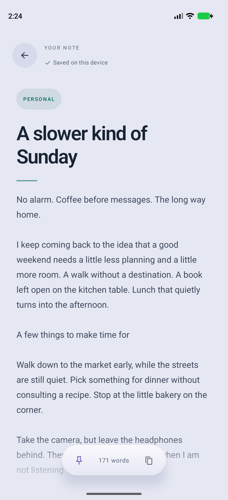
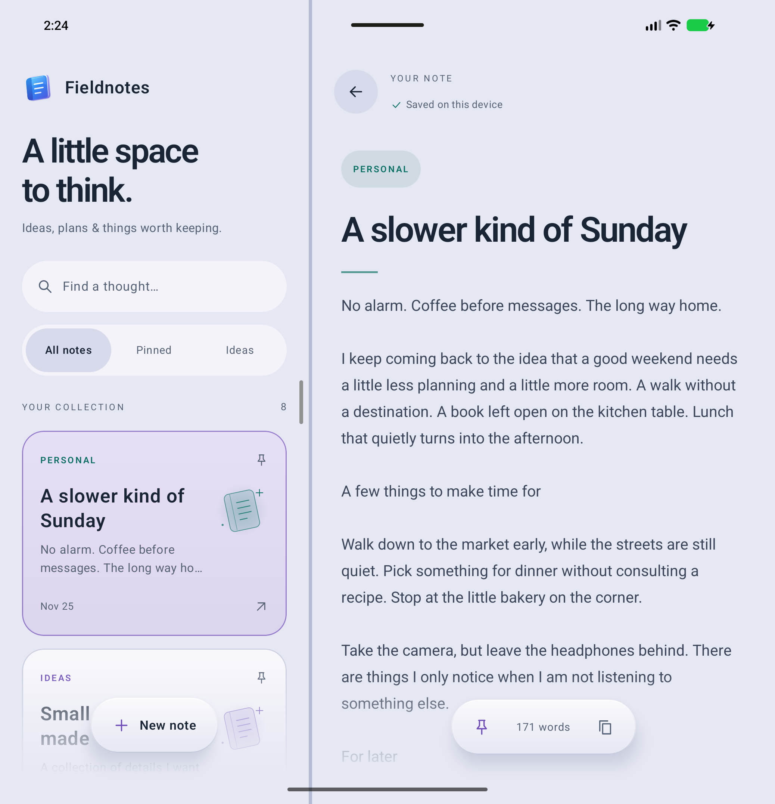

<p align="center"></p>

# Fieldnotes

A notes app accompanying [Making Android Apps Adaptive: Activity Embedding](https://medium.com/p/3e465dd8aca3).

The collection, editor and empty-detail screen are separate Activities, each rendered with Compose. WindowManager arranges them; Koin provides their dependencies through its Kotlin DSL.

## Folded: editor only

The editor fills the smaller window. Back returns to the collection.

<p align="center"></p>

## Unfolded: collection and editor

The two Activities share the window. The divider starts at 40/60 and can be dragged on devices with Window SDK extension 6 or later.

<p align="center"></p>

## Run the sample

Download the [APK](https://github.com/lucf15/activity-embedding-sample/releases/download/v0.1.0/fieldnotes-0.1.0.apk). Notes are stored locally. The optimized APK is signed with a development key.

Android 26 or later is required. Embedding depends on device support and available window space; otherwise, the app uses ordinary list-to-editor navigation.

## Build

Use JDK 21 and Android SDK 37.

```sh
./gradlew :app:assembleAdaptiveDebug :app:assembleClassicDebug
```

- `adaptive` enables Activity Embedding: `io.github.lucf15.adaptivenotes`.
- `classic` uses the same screens without embedding: `io.github.lucf15.adaptivenotes.classic`.

Both variants can be installed together and keep separate note storage.

## Code

- [XML rules](app/src/main/res/xml/activity_embedding_rules.xml): Activity pairs, placeholder, size limits and draggable dividers.
- [Startup](app/src/main/java/io/github/lucf15/adaptivenotes/platform/embedding/EmbeddingSetup.kt): rule registration and optional layout-state saving.
- [Manifest](app/src/main/AndroidManifest.xml): Activity declarations and embedding properties.
- [Editor](app/src/main/java/io/github/lucf15/adaptivenotes/ui/editor/NoteEditorActivity.kt): note selection through initial and subsequent intents.

[Android Activity Embedding documentation](https://developer.android.com/develop/ui/views/layout/activity-embedding).

## License

[Apache 2.0](LICENSE).
